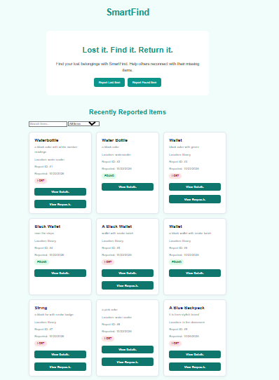
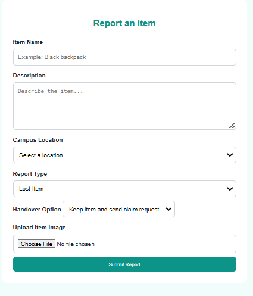
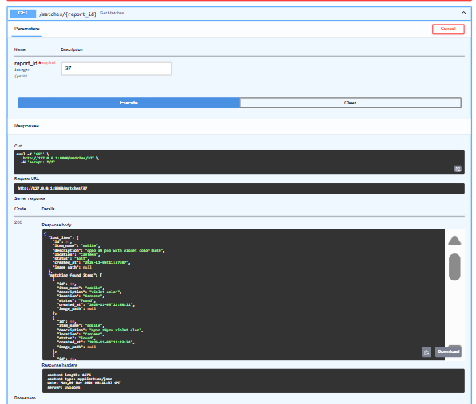
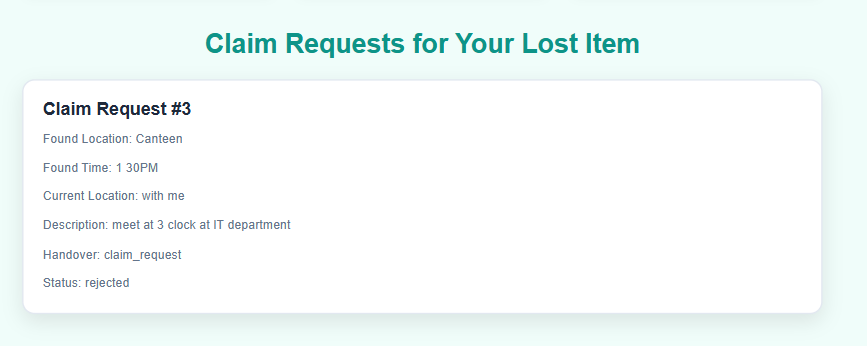
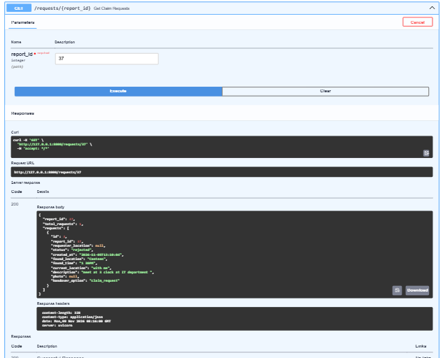

# 🔍 SmartFind – AI-Powered Lost and Found Management System

An AI-powered web application that helps users report lost and found items and identify potential matches using Natural Language Processing (NLP) and semantic similarity.

## 📌 Project Overview

SmartFind aims to simplify the process of finding lost belongings by connecting lost-item reports with found-item reports.

The system uses Sentence Transformers and cosine similarity to identify semantically similar items based on their names and descriptions.

## 🎯 Problem Statement

Traditional lost and found systems rely heavily on manual searching and comparing item descriptions. This makes it difficult to identify matching reports.

SmartFind addresses this problem through AI-based semantic matching, helping users find potentially matching items more efficiently.

## ✨ Features

- Report lost items.
- Report found items.
- Upload item images.
- View recently reported items.
- Search and filter item reports.
- AI-powered semantic item matching.
- View detailed item information.
- Edit and delete reports.
- Submit claim requests.
- View submitted claim requests.
- Accept or reject claim requests.
- Automatically update item status to returned after an accepted claim.
- Automatically reject other pending requests after a claim is accepted.
- User-friendly web interface.

## 🧠 AI Matching Methodology

SmartFind uses the Sentence Transformer model:

**`all-MiniLM-L6-v2`**

The model converts item names and descriptions into numerical embeddings.

Cosine similarity is used to compare the semantic similarity between lost and found reports.

**Matching weights:**
- Item name similarity: 70%
- Description similarity: 30%
- Location is also considered during matching.

## 🛠️ Technologies Used

| Category | Technology |
|---|---|
| Programming Language | Python |
| Backend | FastAPI |
| Frontend | HTML, CSS, JavaScript |
| Database | MySQL |
| NLP Model | Sentence Transformers |
| AI Matching | Cosine Similarity |
| API Testing | FastAPI Swagger UI |

## 📸 Screenshots

### Homepage


### Report Item Form


### AI Matching API


### Claim Request Form


### View Claim Requests API


## 📂 Project Structure

```text
SmartFind/
│
├── main.py
├── database.py
├── README.md
├── requirements.txt
│
├── static/
│   ├── index.html
│   ├── style.css
│   └── script.js
│
├── screenshots/
│   ├── homepage.png
│   ├── report-form.png
│   ├── ai-matching.png
│   ├── claim-request.png
│   └── view-requests-api.png
│
└── uploads/
```

## ⚙️ Installation and Setup

### 1. Clone the Repository

```bash
git clone YOUR_GITHUB_REPOSITORY_URL
```

### 2. Navigate to the Project

```bash
cd smartfind
```

### 3. Create a Virtual Environment

```bash
python -m venv venv
```

### 4. Activate the Virtual Environment

Windows PowerShell:

```powershell
.\venv\Scripts\Activate.ps1
```

### 5. Install Dependencies

```bash
python -m pip install -r requirements.txt
```

### 6. Configure MySQL

- Start MySQL Server.
- Create a database named `smartfind`.
- Configure your MySQL connection details in `database.py` or your environment configuration.
- Ensure the required database tables are created.
- Never upload database passwords or other sensitive credentials to GitHub.

### 7. Run the Application

```bash
python -m uvicorn main:app --reload
```

### 8. Open the Application

Homepage:

`http://127.0.0.1:8000`

FastAPI API Documentation:

`http://127.0.0.1:8000/docs`

## 🔄 Application Workflow

1. Users report lost or found items.
2. Item information and images are stored in MySQL.
3. The AI matching system compares lost and found reports.
4. Potential matches are displayed to help users identify their belongings.
5. Users can submit claim requests.
6. The report owner can accept or reject requests.
7. Accepted claims update the report status to `returned`.

## 🚀 Future Enhancements

- User registration and authentication.
- Admin dashboard.
- Email notifications for matching items.
- Improved image-based item recognition.
- Deployment with a cloud-hosted database.

## 👩‍💻 Author

**Keerthana K S**

B.Tech – Artificial Intelligence and Data Science

GitHub: [keerthna31ks-web](https://github.com/keerthna31ks-web)

LinkedIn: [Keerthana K S](https://linkedin.com/in/keerthana-k-s-a02055357)

---

*SmartFind – Making lost things easier to find.*